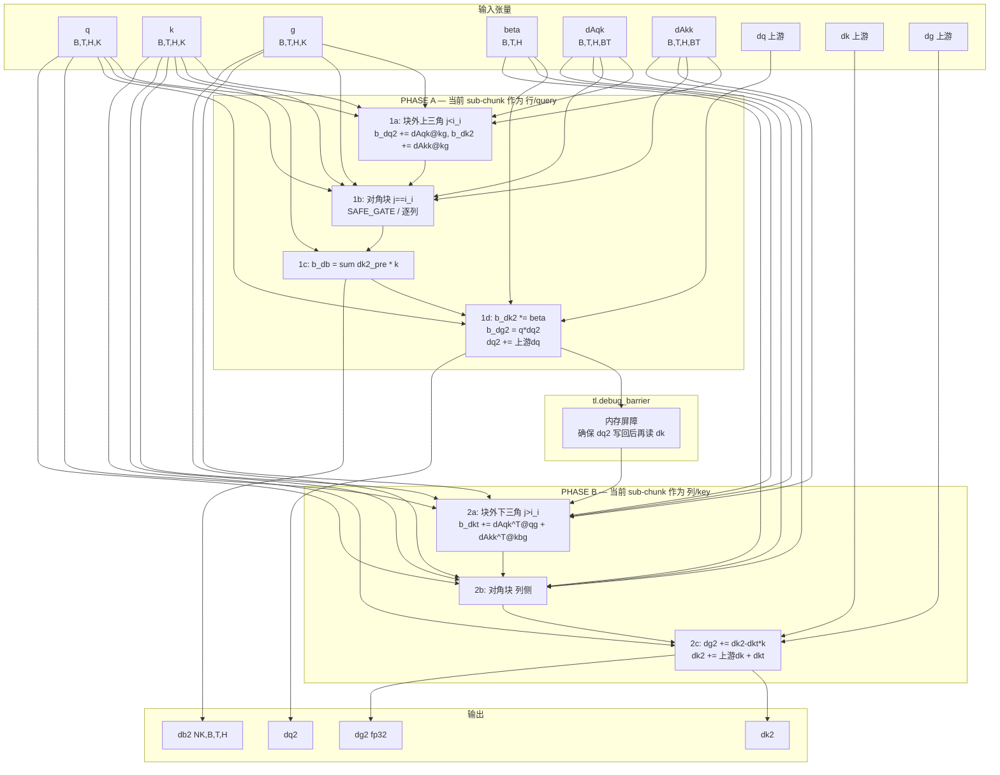
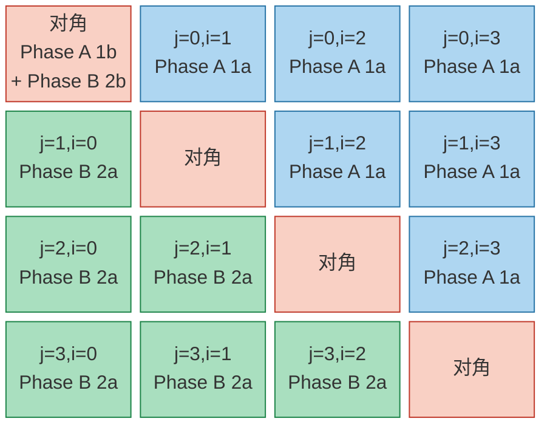

# chunk_intra

chunk 内（intra-chunk）求解：前向的 inter-solve / sub-chunk 与反向的 intra 反传。文件内 4 个 kernel，独占全套件耗时第一（scalar bound）与第三。

> 源文件 `chunk_intra.py`（1069 行）。本目录是该算子的独立归档。

## 包含的 kernel

| kernel | 行号 | 是否纳入瓶颈采集 |
|---|---|---|
| `chunk_kda_fwd_kernel_inter_solve_fused` | 45 | ✅ |
| `chunk_kda_bwd_kernel_intra` | 401 | ✅ |
| `chunk_kda_fwd_kernel_intra_sub_chunk` | 666 | ✅ |
| `chunk_kda_fwd_kernel_intra_sub_chunk_solve` | 843 | — |

对外入口：`chunk_kda_fwd_intra` (L889)、`chunk_kda_bwd_intra` (L1000)

## 瓶颈数据（varlen 8k 用例）

固定用例：`test_megatron_varlen[H32-cu[0, 2048, 4096, 8192]-safe_gateTrue-lb-5.0-torch.bfloat16]`
（varlen 3 段 2048/2048/4096，总 T=8192，H=32，D=128，`safe_gate=True`，`lower_bound=-5.0`，bfloat16）

| kernel | 阶段 | 调用次数 | 总耗时(us) | 占比 | 瓶颈类别 |
|---|---|---|---|---|---|
| `chunk_kda_fwd_kernel_inter_solve_fused` | fwd | 1 | 2040 | 4.1% | vec bound |
| `chunk_kda_bwd_kernel_intra` | bwd | 1 | 24124 | 47.9% | scalar bound |
| `chunk_kda_fwd_kernel_intra_sub_chunk` | fwd | 1 | 5547 | 11.0% | vec bound |

流水线占比明细（ratio = 该单元活跃时间 / 核活跃时间，取各 block 最大值）：

| kernel | vec | cube | scalar | mte_max | 备注 |
|---|---|---|---|---|---|
| `chunk_kda_fwd_kernel_inter_solve_fused` | 0.374 | 0.082 | 0.345 | 0.304 | vec 略高于 scalar(0.345) 和 mte3(0.304)，三者接近属均衡带 |
| `chunk_kda_bwd_kernel_intra` | 0.379 | 0.034 | 0.658 | 0.489 |  |
| `chunk_kda_fwd_kernel_intra_sub_chunk` | 0.546 | 0.017 | 0.401 | 0.218 | vec 略高于 scalar(0.401)，sub_chunk 稳定路径 |

## 测试

源仓无逐算子单测。本算子由端到端用例覆盖：
`triton_ascend/attention/fla/kda/tests/test_kda_chunk.py`（经公开入口 `chunk_kda` 驱动）。

## 来源

- 仓库 `triton-ascend-kernels`，分支 `kda_a5_v2`，commit `636a2de`
- 源路径 `src/triton_ascend_kernels/attention/fla/kda/chunk_intra.py`
- 改动：**仅将包内相对导入改写为仓内绝对导入**；文件头版权块与全部代码逻辑逐字节未动


---

## 附：原 `chunk_intra_bwd_analysis.md`

> 源仓同目录的分析文档，原文并入（标题层级已下调 2 级）。
> 文中引用的 `chunk_intra.py` 行号在本次迁移后**仍然有效**——import 改写只替换了行内文本，未增删任何行。

### `chunk_kda_bwd_kernel_intra` 算子逻辑分析报告

> 源文件：`src/triton_ascend_kernels/attention/fla/kda/chunk_intra.py:361`
> 包装函数：`chunk_kda_bwd_intra` (line 809)

#### 1. 概述与上下文

`chunk_kda_bwd_kernel_intra` 是 flash-linear-attention 中 **KDA（带门控的 chunk 线性注意力）** 反向传播的 **intra-chunk（块内）** 核心 Triton kernel。

它负责在反向传播中，由注意力矩阵的梯度 `dAqk` / `dAkk` 反推出 `q, k, g(ate), beta` 四个输入的梯度。块间（inter-chunk）部分由其他 kernel 处理，本 kernel 只处理单个 chunk（大小 `BT`）内部的依赖。

##### 算子签名（包装函数 `chunk_kda_bwd_intra`，line 809）

| 输入 / 输出 | 张量 | shape | 说明 |
|---|---|---|---|
| 输入 | `q, k, g` | `(B, T, H, K)` | query / key / 门控 |
| 输入 | `beta` | `(B, T, H)` | 数据相关门控系数 |
| 输入 | `dAqk, dAkk` | `(B, T, H, BT)` | 注意力矩阵梯度（每 chunk 一个 `BT×BT` 块，展平存储） |
| 输入 | `dq, dk, dg, db` | `(B,T,H,K)` / `(B,T,H)` | 上游已累积的部分梯度（块间贡献） |
| 输出 | `dq2, dk2` | `(B, T, H, K)` | 完整的 q/k 梯度（= 上游 + 块内贡献） |
| 输出 | `dg2` | `(B, T, H, K)`，fp32 | gate 梯度 |
| 输出 | `db2` | `(NK, B, T, H)`，fp32 | beta 梯度（最后 `sum(0)` 聚合） |

##### 关键常量（line 825-834）

```
BT = 64           # chunk 大小
BC = 16           # sub-chunk 大小（BT 被切成 4 个 sub-chunk）
BK = min(32, next_pow2(K))   # K 维分块
NC = BT / BC = 4  # 一个 chunk 内的 sub-chunk 数
NK = ceil(K / BK) # K 维分块数
NT = ceil(T / BT) # chunk 数
```

##### Grid 与并行划分（line 840）

```
grid = (NK * NC, B * H)
i_kc = program_id(0)  ->  i_k = i_kc // NC (K 块编号)
                         i_i = i_kc %  NC (sub-chunk 编号 0..3)
i_bh = program_id(1)  ->  i_b, i_h
```

每个 program 处理「1 个 batch-head × 1 个 K 块 × 1 个 sub-chunk」，**内部串行循环遍历所有 `NT` 个 chunk**（line 398）。这是一种典型的「外层 batch/head/K/子块并行 + 内层 chunk 串行」布局，有利于复用 `dAqk/dAkk` 寄存器、减少全局内存流量。

---

#### 2. 数学公式

##### 2.1 前向公式（需被微分的对象）

设当前 chunk 内 sub-chunk $i$（行，query 侧）与 sub-chunk $j$（列，key 侧），位置 $p,q \in [0,BC)$，特征维度 $d$。记门控归一化常数 $g_n$（取 sub-chunk 边界值以稳定数值），定义门控比：

$$\gamma_q[p,d] = 2^{g[i,p,d] - g_n[d]}, \qquad \gamma_k[q,d] = 2^{g_n[d] - g[j,q,d]}$$

则两个注意力矩阵块为：

$$
A_{qk}[i,j]_{p,q} = s \sum_d q_{i,p,d}\,\gamma_q[p,d] \cdot k_{j,q,d}\,\gamma_k[q,d]
$$

$$
A_{kk}[i,j]_{p,q} = \beta_{i,p}\cdot s \sum_d k_{i,p,d}\,\gamma_q[p,d] \cdot k_{j,q,d}\,\gamma_k[q,d]
$$

其中 $s$ = `scale`。$A_{qk}$ 为下三角（含对角），$A_{kk}$ 为严格下三角。

> 注：使用 `exp2`（底数 2）而非 `exp` 是因为硬件上 `exp2` 更快；对应的对数底数为 $\ln 2$。

##### 2.2 反向梯度公式

给定上游梯度 $\bar A_{qk}, \bar A_{kk}$（代码中 `dAqk`, `dAkk`），链式法则求导。记标量内积贡献 $C_{p,q,d} = q_{i,p,d} k_{j,q,d} 2^{g_{i,p,d}-g_{j,q,d}}$（已吸收 $\gamma$），则：

**(a) query 梯度**（当前 sub-chunk 作为「行」时）

$$
\frac{\partial L}{\partial q_{i,p,d}} \mathrel{+}= \sum_{j,q} \bar A_{qk}[i,j]_{p,q} \cdot k_{j,q,d}\cdot 2^{g_{i,p,d}-g_{j,q,d}}
$$

**(b) key 梯度**（两部分相加）

当前 sub-chunk 作为「行」（$A_{kk}$ 中 $k_i$ 出现）：

$$
dk^{\text{row}}_{i,p,d} = \beta_{i,p}\sum_{j,q} \bar A_{kk}[i,j]_{p,q} \cdot k_{j,q,d}\cdot 2^{g_{i,p,d}-g_{j,q,d}}
$$

当前 sub-chunk 作为「列」（$A_{qk}, A_{kk}$ 中 $k_j$ 出现）：

$$
dk^{\text{col}}_{i,p,d} = \sum_{m < i,\,r} \bar A_{qk}[m,i]_{r,p} \cdot q_{m,r,d}\cdot 2^{g_{m,r,d}-g_{i,p,d}} + \sum_{m,\,r} \bar A_{kk}[m,i]_{r,p} \cdot \beta_{m,r}\,k_{m,r,d}\cdot 2^{g_{m,r,d}-g_{i,p,d}}
$$

总 $dk = dk^{\text{row}} + dk^{\text{col}} + \text{上游 } dk$。

**(c) beta 梯度**

由于 $A_{kk}[i,j]_{p,q}$ 对 $\beta_{i,p}$ 是线性因子：

$$
\frac{\partial L}{\partial \beta_{i,p}} = \sum_d k_{i,p,d} \cdot \underbrace{\left(\sum_{j,q} \bar A_{kk}[i,j]_{p,q} \cdot k_{j,q,d}\cdot 2^{g_{i,p,d}-g_{j,q,d}}\right)}_{dk^{\text{row}}_{i,p,d}\,/\,\beta_{i,p} \text{（乘 }\beta\text{ 之前）}}
$$

即代码 line 496：`b_db = sum(b_dk2 * b_k, axis=1)`，**必须在 `b_dk2 *= b_b` 之前**计算。

**(d) gate 梯度**

$g$ 同时出现在 $\gamma_q$（$+g$ 指数）和 $\gamma_k$（$-g$ 指数），因此 query 侧与 key 侧符号相反。利用 $\frac{d}{dx}2^{x} = \ln 2 \cdot 2^{x}$，并消去公共归一化项：

query 侧（当前 sub-chunk 作为行）：

$$
dg^{\text{row}}_{i,p,d} = q_{i,p,d} \cdot dq^{\text{in}}_{i,p,d}
$$

其中 $dq^{\text{in}}$ 是 (a) 中累加结果（代码 `b_dq2`）。见 line 503。

key 侧（当前 sub-chunk 作为列）。$+g$ 项来自 $A_{kk}$（$k_i$ 在指数 $+g_{i}$ 上）：

$$
dg^{\text{col, pos}}_{i,p,d} = k_{i,p,d}\cdot dk^{\text{row}}_{i,p,d}
$$

$-g$ 项来自 $A_{qk},A_{kk}$ 中作为 key 的 $2^{g_m - g_i}$：

$$
dg^{\text{col, neg}}_{i,p,d} = -k_{i,p,d}\cdot dk^{\text{col}}_{i,p,d}
$$

合并（代码 line 589）：

$$
dg_2 = (dk^{\text{row}} - dk^{\text{col}}) \odot k_{i} + \text{上游 } dg
$$

---

#### 3. 伪代码

```
PROG(i_k, i_i, i_b, i_h):                       # 一个 program
  o_k = i_k*BK .. i_k*BK+BK                     # 该 program 负责的特征维度范围
  for i_t in 0 .. NT-1:                         # 遍历所有 chunk（串行）
      bos, T_local = seq_bounds(i_b, i_t)       # 变长 / 定长寻址
      i_ti = i_t*BT + i_i*BC                    # 当前 sub-chunk 起始行
      if i_ti >= T_local: continue

      # ---- 载入当前 sub-chunk 的 q/k/g/beta (本 program 的 BK 列) ----
      b_q, b_k = load(q, k)[i_ti : i_ti+BC, o_k]   # (BC, BK)
      b_g = load(g)[i_ti : i_ti+BC, o_k]            # (BC, BK)
      b_b = load(beta)[i_ti : i_ti+BC]              # (BC,)
      b_dq2 = 0; b_dk2 = 0                          # (BC, BK) 累加器

      # ================= PHASE A: 作为「行/query」侧 =================
      # (1a) 块外上三角 j < i_i：用 dAqk[i, j], dAkk[i, j]
      if i_i > 0:
          gn = g[i_ti, o_k]                              # 归一化门（sub-chunk 起点）
          for j in 0 .. i_i-1:
              k_j  = load(k)[i_t*BT + j*BC, o_k]
              g_j  = load(g)[i_t*BT + j*BC, o_k]
              kg_j = k_j * 2^(gn - g_j)                  # (BC, BK) key 侧门控
              dq_j = load(dAqk)[i_ti, j*BC]              # (BC, BC)
              dk_j = load(dAkk)[i_ti, j*BC]
              b_dq2 += dq_j @ kg_j                       # (BC,BK) += (BC,BC)@(BC,BK)
              b_dk2 += dk_j @ kg_j
          # 把 query 侧门控 gq = 2^(g - gn) 乘回去
          gq = 2^(b_g - gn)
          b_dq2 *= gq
          b_dk2 *= gq

      # (1b) 对角块 j == i_i
      if SAFE_GATE:                                       # 矩阵化快路径
          gn = g[i_ti + BC//2, o_k]                       # 中点门（数值稳定）
          dAqk_d = load(dAqk)[i_ti, i_i*BC]               # (BC, BC)
          dAkk_d = load(dAkk)[i_ti, i_i*BC]
          k_exp = b_k * 2^(gn - b_g)                      # key 侧（-g）
          b_dq2 += (dAqk_d @ k_exp) * 2^(b_g - gn)        # 再乘 query 侧（+g）
          b_dk2 += (dAkk_d @ k_exp) * 2^(b_g - gn)
      else:                                               # 标量逐列循环（精确，慢）
          for j in 0 .. BC-1:
              dAqk_j = load(dAqk)[i_ti+j]                 # (BC,)
              dAkk_j = load(dAkk)[i_ti+j]
              k_j  = load(k)[i_ti+j, o_k]
              g_j  = load(g)[i_ti+j, o_k]
              mask = (row_idx >= j)                       # 下三角
              gqk  = 2^(b_g - g_j)
              b_dq2 += where(mask, dAqk_j[:,None] * k_j[None,:] * gqk, 0)
              b_dk2 += where(mask, dAkk_j[:,None] * k_j[None,:] * gqk, 0)

      # (1c) beta 梯度（必须在乘 beta 之前）
      b_db = sum(b_dk2 * b_k, axis=1)                     # (BC,)
      b_dk2 *= b_b[:, None]                               # 给 dk_row 乘上 beta

      # (1d) gate 梯度（query 侧）+ 累加上游 dq + 写出
      b_dg2 = b_q * b_dq2
      b_dq2 += load(dq)[i_ti, o_k]                        # 加块间上游
      store(dq2)[i_ti, o_k] = b_dq2
      store(db)[i_ti]      = b_db

      ----------------- debug_barrier (保证 dq2 写回后再读 dk) -----------------

      # ================= PHASE B: 作为「列/key」侧 =================
      b_dkt = 0                                           # (BC, BK) 列侧 dk 累加器

      # (2a) 块外下三角 j > i_i：用 dAqk[j, i]^T, dAkk[j, i]^T
      NC_loc = min(NC, ceil((T_local - i_t*BT) / BC))
      if i_i < NC_loc - 1:
          gn = g[min(i_ti+BC, T_local) - 1, o_k]          # 归一化门（sub-chunk 末点）
          for j in i_i+1 .. NC_loc-1:
              q_j  = load(q)[i_t*BT + j*BC, o_k]
              k_j  = load(k)[i_t*BT + j*BC, o_k]
              b_j  = load(beta)[i_t*BT + j*BC]
              g_j  = load(g)[i_t*BT + j*BC, o_k]
              gjn = 2^(g_j - gn)
              qg_j  = q_j       * gjn
              kbg_j = k_j * b_j * gjn
              dAqk_t = load(dAqk)^T[j*BC, i_i*BC]         # (BC, BC) 转置读
              dAkk_t = load(dAkk)^T[j*BC, i_i*BC]
              b_dkt += dAqk_t @ qg_j
              b_dkt += dAkk_t @ kbg_j
          b_dkt *= 2^(gn - b_g)                            # 乘回当前块门 (-g)

      # (2b) 对角块（列侧）
      if SAFE_GATE:
          gn = g[i_ti + BC//2, o_k]
          dAqk_d = load(dAqk)^T[i_i*BC, i_ti]
          dAkk_d = load(dAkk)^T[i_i*BC, i_ti]
          b_dkt += (dAqk_d @ (b_q       * 2^(b_g - gn))) * 2^(gn - b_g)
          b_dkt += (dAkk_d @ (b_k*b_b   * 2^(b_g - gn))) * 2^(gn - b_g)
      else:
          for j in 0 .. BC-1:
              ... 类似 (1b)，mask 改为 row_idx <= j，转置读 dA...

      # (2c) 合并 dk / dg 并写出
      b_dg2 += (b_dk2 - b_dkt) * b_k + load(dg)[i_ti, o_k]   # key 侧 gate
      b_dk2 += load(dk)[i_ti, o_k] + b_dkt                   # 上游 + 列侧
      store(dk2)[i_ti, o_k] = b_dk2
      store(dg2)[i_ti, o_k] = b_dg2
```

包装层（line 869-872）做最后聚合：
- `dq = dq2`，`dk = dk2`，`dg = dg2`
- `db = db2.sum(0).add_(db)`：因为每个 K 块各算了一份 beta 梯度，需沿 `NK` 维求和后并入上游。

---

#### 4. 计算图

##### 4.1 数据依赖总图



##### 4.2 单个 chunk 内 sub-chunk 交互矩阵

下图展示一个 chunk（`BT=64`，切成 `NC=4` 个 `BC=16` 子块）中，哪些 `(行 i_i, 列 i_j)` 块被哪个阶段处理：



- 红色：对角块（Phase A 与 Phase B 都要处理，含下三角 mask）
- 蓝色：严格上三角由 Phase A 1a 处理（当前 sub-chunk 作 query 行）
- 绿色：严格下三角由 Phase B 2a 处理（当前 sub-chunk 作 key 列，转置读 dA）

> 每个 program 只负责「第 `i_i` 行」：Phase A 遍历该行左侧（蓝），Phase B 遍历该列下方（绿）。完整 `BT×BT` 块由 `NC` 个 program 协作覆盖。

---

#### 5. Shape 变换追踪

以默认配置 `BT=64, BC=16, BK=32, K=64` 为例。所有块内张量布局为 `(BC, BK)` 或 `(BC, BC)`，行主序。

```mermaid
flowchart LR
    subgraph loads["载入 (per sub-chunk, per K-block)"]
        L1["q,k,g<br/>load block_ptr<br/>--BC x BK--><br/>(16, 32)"]
        L2["beta<br/>--BC--><br/>(16,)"]
        L3["dAqk, dAkk<br/>--BC x BC--><br/>(16, 16)"]
    end

    subgraph phaseA["Phase A 计算"]
        PA0["累加器<br/>b_dq2, b_dk2<br/>(16, 32) zeros"]
        PA1["kg = k_j * exp2<br/>(16, 32)"]
        PA2["dAqk @ kg<br/>(16,16)@(16,32)<br/>=> (16, 32)"]
        PA3["*= exp2(g-gn)<br/>(16, 32) 点乘 (1,32)<br/>广播 => (16, 32)"]
        PA4["b_db = sum(dk2*k, dim=1)<br/>(16,32)*(16,32) ->sum-> (16,)"]
        PA5["b_dk2 *= beta[:,None]<br/>(16,32) * (16,1) => (16,32)"]
        PA6["b_dg2 = q * dq2<br/>(16,32)"]
        PA7["+上游dq, store dq2<br/>(16,32)"]
    end

    subgraph phaseB["Phase B 计算"]
        PB0["累加器<br/>b_dkt = zeros<br/>(16, 32)"]
        PB1["qg = q_j*exp2, kbg=k_j*beta*exp2<br/>(16, 32)"]
        PB2["dA^T @ qg<br/>(16,16)@(16,32) => (16, 32)"]
        PB3["*= exp2(gn-g)<br/>(16, 32)"]
        PB4["dg2 += (dk2 - dkt)*k<br/>(16,32)-(16,32) => *(16,32) => (16,32)"]
        PB5["dk2 += 上游dk + dkt<br/>(16,32)"]
    end

    loads --> phaseA --> Barrier["debug_barrier"] --> phaseB
```



##### 全局张量 shape 汇总

| 张量 | 全局 shape | kernel 内 view（program 视角） | 步幅 (H,K) 含义 |
|---|---|---|---|
| `q, k, g` | `(B, T, H, K)` | 按 `(bos*H + i_h)*K` 偏移，`block_ptr` 取 `(BC, BK)` / `(BC, BC)` | 行步长 `H*K`，列步长 1 |
| `beta` | `(B, T, H)` | `bos*H + i_h` 偏移，1D `(BC,)` | 行步长 `H` |
| `dAqk, dAkk` | `(B, T, H, BT)` | 按 `(bos*H + i_h)*BT` 偏移，`(BC, BC)`；Phase B 用 `(1, H*BT)` 转置步长读 | 行步长 `H*BT`，列步长 1 |
| `dq, dk, dg` (上游) | `(B, T, H, K)` | `load -> (BC, BK)` | 同 q |
| `dq2, dk2` | `(B, T, H, K)` | `store <- (BC, BK)` | 同 q |
| `dg2` | `(B, T, H, K)` fp32 | `store <- (BC, BK)` | 同 q |
| `db` (kernel 内) | `(NK, B*T, H)` | `db_local = db + (i_k*all + bos)*H + i_h`，1D `(BC,)` | 行步长 `H`，**外层 `i_k` 索引 NK** |

##### 编码索引推导

```
i_bh = i_b * H + i_h            (batch, head) -> 一维
i_kc = i_k * NC + i_i           (K-block, sub-chunk) -> 一维
i_ti = i_t * BT + i_i * BC      chunk 内绝对行号
bos  = i_b * T   (定长)  或  cu_seqlens[i_n]  (变长)
```

变长模式（`IS_VARLEN`）下，`chunk_indices` 给出 `(i_n, i_t)` 二元组，`T_local = cu_seqlens[i_n+1] - cu_seqlens[i_n]`，所有 `block_ptr` 第 0 维用 `T_local` 做边界掩码。

---

#### 6. 关键设计要点

1. **两阶段分离 + barrier**：Phase A 先把 `dq2/db/dg2(query侧)` 写回全局，`tl.debug_barrier()`（line 508）保证同一 program 内写读顺序；不同 program 间因 `dq2/dk2` 各管各自 sub-chunk 无数据竞争。`dq2` 用独立 buffer 而非原地累加，避免 Phase A/B 间读写冒险。

2. **SAFE_GATE 双路径**：
   - `SAFE_GATE=True`：对角块用 `gather`/中点门 `gn` 矩阵化（`dA @ k_exp * exp`），一次 `tl.dot` 完成，快但需 `gather` 支持。
   - `SAFE_GATE=False`：标量逐列循环 `for j in range(BC)`，精度更高但慢 `BC` 倍。

3. **门控归一化技巧**：Phase A 用「sub-chunk **起点**门」`gn=g[i_ti]`，Phase B 用「**末点**门」`gn=g[i_ti+BC-1]`。两次 `exp2` 相乘 `(2^(g-gn))·(2^(gn-g))` 抵消回 `2^(g_i-g_j)`，但中间值被夹在 `[2^(-85), 2^85]` 内避免溢出。

4. **beta 梯度的时机依赖**：`b_db` 必须在 `b_dk2 *= b_b` 之前算（line 496->497），因为乘 beta 后就丢失了「未乘 beta 的原始 Akk 对 k_i 的导数」。

5. **NK 维度的 beta 归约**：每个 K 块独立写入 `db2[i_k]`，最后包装层 `db2.sum(0)`（line 871）合并——因为 beta 梯度对 K 维是求和，分块计算后必须跨块归约。

6. **变长/定长统一**：通过 `IS_VARLEN` 编译常量分支化，循环内每个 chunk 独立取 `bos/T_local`，支持同一 kernel 处理 packed 序列。
